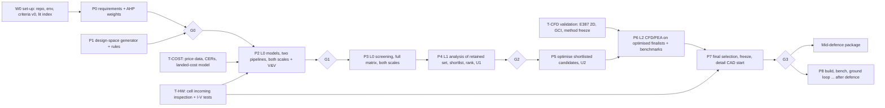

# FYDP Execution Plan: Phases P0–P7, Gates G0–G3 (12 Nov – 13 Dec 2026)

**Project:** Modular Solar-Electric UAV for Emergency Telecommunications: A Low-Altitude Proof-of-Concept for Energy-Optimised, Multi-Payload HALE Platforms
**Team:** Syed Shah Umer (lead), Ateeq-ur-Rehman, Muhammad Hayat Arain. **Supervisor:** Mr. Aun Haider, NUST SMME
**Document type:** Operational plan for a human team working with AI coding/research agents (human-in-the-loop)
**Version:** 1.2, 15 Nov 2026 (1.2: OR-Tools CP-SAT replaced by exhaustive enumeration and SciPy `milp` in 8/9/12.2 because its Windows build clashes with the conda libraries; literature folder layout, reading rules and intake tools in 3.2 and 3.8; cards T-LIT.00 and T-LIT.03; public repository, individual accounts and drive-only text copies in 3.4. 1.1: repository layout completed; P2 start rule clarified in Section 4; GitHub plan note in 3.4; large-file policy in 3.2)
**Authoritative inputs:** Synopsis Report (PDF, Oct 2026); Title and Synopsis Defence deck (22 slides, incl. hidden slides 8, 9, 20, 22); FYDP Policy (Aero) Rev 03, Aug 2026; team decisions recorded in Section 1.4

---

## 0. How to use this document

### 0.1 Readers
- **Humans (team, supervisor):** read Sections 1–6 and 14–16 first. Section 5 is the week-by-week plan. Section 6 defines what each gate needs before sign-off.
- **AI agents:** read Sections 2 and 3 (rules and operating protocol) before taking any task. Each task in Section 5 is written as a task card with inputs, method, outputs, acceptance tests and dependencies. An agent never starts a task whose dependencies are not marked `VERIFIED`.

### 0.2 Status vocabulary (used in the repository task board)
| Status | Meaning |
|---|---|
| `BLOCKED` | A dependency is not yet `VERIFIED` |
| `READY` | All dependencies `VERIFIED`; may start |
| `IN-PROGRESS` | Being executed by an agent or a human |
| `SUBMITTED` | Outputs and evidence committed; awaiting review |
| `VERIFIED` | Passed its acceptance tests and was approved by the named human reviewer |
| `REWORK` | Failed review; reasons recorded in the card |
| `DESCOPED` | Deliberately dropped under Section 15.2, with the reason recorded |

### 0.3 Naming
- Phases `P0`–`P11`, gates `G0`–`G5`, uncertainty checkpoints `U1`–`U4` follow the synopsis and deck.
- Fidelity levels: `L0` analytic, `L1` low fidelity (panel/VLM/airfoil codes), `L2` medium fidelity (RANS CFD, FEA), `L3` own measurements.
- Scales: `FS` full scale (analysed only), `DM` demonstrator (built and flown). Every candidate carries a linked pair of IDs: `FS-xxxx` ↔ `DM-xxxx`.
- Tasks: `T-<phase>.<number>`, e.g. `T-P2.07`. Parallel tracks: `T-CFD.nn`, `T-HW.nn`, `T-COST.nn`, `T-LIT.nn`, `T-DOC.nn`, `T-REG.nn`.

---

## 1. Context snapshot (frozen facts and constraints)

### 1.1 What the project must produce by the mid-defence
The work up to and including the configuration freeze (P0–P7, gates G0–G3), presented as verifiable evidence: requirement register and weights; the explored and linked design, requirement and cost spaces; verified and validated scripts; screening, ranking and optimisation results with uncertainty (U1, U2); CFD/FEA on finalists and benchmarks; the frozen FS and DM configurations; and the first measured hardware data (solar-cell incoming tests).

### 1.2 Calendar
| Window | Dates (2026) | Purpose |
|---|---|---|
| W0 (set-up) | Thu 12 – Sun 15 Nov | Repository, environment, agent protocol, literature ingestion start |
| W1 | Mon 16 – Sun 22 Nov | P0 requirements and weights (G0); P1 design-space generator; P2 model build starts; CFD validation set-up starts |
| W2 | Mon 23 – Sun 29 Nov | P2 verification and validation (G1); P3 L0 screening of the full matrix; P4 L1 set-up |
| W3 | Mon 30 Nov – Sun 6 Dec | P4 L1 shortlist, ranking, U1 (G2); P5 optimisation, U2; P6 L2 production runs start |
| W4 | Mon 7 – Sun 13 Dec | P6 complete; P7 selection and freeze (G3); detail CAD starts; mid-defence package |
| Defence | Date to be announced; expected between 14 and 23 Dec | 10-min presentation + 5-min Q&A, progress report form (Policy Rev 03, §17.a.ii) |

Gate target dates: **G0 Thu 19 Nov · G1 Thu 26 Nov · G2 Wed 2 Dec · G3 Thu 10 Dec (latest Sun 13 Dec)**. Mid-defence package frozen **Sat 12 Dec**. If the defence is set later, the slack goes first to P6 (more L2 cases) and second to P7 detail CAD; gate criteria do not loosen.

### 1.3 Exogenous limits (from the synopsis; not design variables)
- Budget ≤ PKR 500,000 for everything, spares included.
- DM take-off mass < 10 kg (lower preferred).
- Flight: visual line of sight, ≤ 1,000 ft AGL, about 400–500 ft nominal; window February – April 2027.
- Permission: NUST (on campus) or Civil Aviation Authority (off campus).
- Buildability with available means; transportability.
- HALE-class aspect-ratio floor on the induced-drag-equivalent aspect ratio: AR_eff ≥ 15 during exploration, raised to 20 after the first tier; strict (within error) at FS, with a declared tolerance at DM.
- FS operating point: 20 km over Islamabad (33.7° N, 73.1° E); payload powered continuously.

### 1.4 Team decisions recorded on 11 Nov 2026 (bind this plan)
1. **Dates.** Work finishes by the end of W4 at the latest; the defence will fall before the late-December/early-January examinations.
2. **Committed hardware.** Solar cells (SunPower Maxeon Gen III, 1/3-cut, 125 × 41.6 mm, 150 pieces, ordered), the battery cell type (Molicel INR-21700-P50B, 4S packs) and the MPPT class (boost, 4S Li-ion output) were procured independently of the design. They are **declared technology constraints of the DM design space**. The FS design space remains technology-open. This is stated in the report and the defence.
3. **Span.** The 2.5–3.5 m DM span came from preliminary calculations; 3.5 m reflects the budget. The DM design space is explored over a wider range; the budget (through the cost model) and the mass limit decide the admissible part. Nothing is excluded by assumption.
4. **Nothing exists yet.** Requirement register, weights, design-space definition, both pipelines, validation runs and the cost model are all built in this plan. Earlier exploratory scripts may be consulted as references only; they are not trusted code.
5. **Compute and licences.** ANSYS Fluent (full licence), nTop (educational licence), AVL, VORLAX, Tecplot, Flow360 Python client (credit status unknown), SolidWorks. Hardware: personal laptops; best GPU an RTX 3050. No confirmed cluster access.
6. **Design-space breadth.** The full morphological matrix is generated and processed. Machine learning is used where it measurably reduces cost or improves coverage, inside a physics-first hierarchy (Section 8.6).
7. **Agents.** Agent-agnostic protocol (Claude Code, Antigravity, Hermes or others). One shared Git repository. Every gate is signed by the team and by the supervisor, with verification and validation evidence traceable to credible sources.
8. **Method choice.** Use the methods that perform best in this context, justified by literature and by measured performance on this project (held-out errors, benchmark comparisons).
9. **Hardware data for the defence.** Solar cells are due within days and are tested in this window. The battery and MPPT may arrive after the defence; their bench data are not on the critical path.
10. **Work division** follows hidden slide 20 as the default assignment of human reviewers; any team member may review any card.
11. **Tools available to agents** may also come from the workspace directories pointed to in the agent prompt.
12. **Literature.** About 200 PDFs, AI-generated gap reports, CSV and text source lists and full literature-review documents are handed directly to the agents. Section 3.8 defines how they are ingested and cited.

---

## 2. Non-negotiable rules

These apply to every task, human or agent. A violation sends the card to `REWORK` regardless of its results.

1. **Verification is not validation.** Verification shows the code solves its equations correctly (hand calculations, limiting cases, convergence, code-to-code). Validation shows the model represents reality (published measurements, wind-tunnel data, flown-aircraft data, own measurements). Agreement between two codes is never reported as validation.
2. **Acceptance criteria are declared before the run.** Every quantitative check has its pass rule, tolerance and data source written into `acceptance/criteria.yaml` and committed (Git tag `criteria-vN`) **before** the run it judges. Criteria are never tuned afterwards. Changes require a new version with a written reason and team sign-off.
3. **Provenance for every number.** Every constant, input and result traces to a source: a citation with page/table/figure, a dataset with its access date and query, a supplier quote, a measurement log, or a run ID. Unsourced numbers are not allowed in code, reports or slides.
4. **No synthetic data presented as measured.** Generated, assumed or surrogate-predicted values are labelled as such everywhere they appear (deck slide 18 commitment).
5. **SI units internally.** Conversions happen only at input/output boundaries and are unit-tested.
6. **Uncertainty travels with results.** Every reported performance number carries an uncertainty or a range. Screening is uncertainty-aware: a candidate is dropped only if it fails at its optimistic bound.
7. **Reproducibility.** Every run records code commit hash, environment lock, input files hash, random seeds, start/end time and machine. Any result in the report can be regenerated from its run manifest.
8. **Two-key rule.** No output becomes `VERIFIED` on an agent's word. A named human reviewer approves it after reading the evidence. Gate-critical outputs (Section 6) additionally need an independent check by a second agent or a second human who did not produce them.
9. **Literature claims are quoted, not paraphrased into new facts.** A claim taken from a paper is recorded with the exact supporting passage and location in the evidence register (Section 3.8). An agent that cannot find the passage marks the claim `UNSUPPORTED`.
10. **Stop rules.** If a validation case fails its pre-declared criterion, the dependent phase does not start. The team either fixes the model (with the fix documented) or narrows the model's declared domain of validity.

---

## 3. Operating model: agents, humans and the repository

### 3.1 Roles
| Role | Who | Responsibilities |
|---|---|---|
| Gate authority | Whole team + supervisor | Approve G0–G3 using the gate checklists in Section 6 |
| Card reviewer | One named team member per card (default: slide 20 lead) | Reads evidence, runs or spot-checks tests, approves or returns the card |
| Builder agent | Any AI agent | Executes a card: writes code, runs analyses, drafts documents, commits outputs and evidence |
| Checker agent | A different agent (different model or vendor where possible) | Independently reviews gate-critical outputs: re-derives equations, re-runs tests, checks citations |
| Integrator | Ateeq (default) | Keeps the task board, dependency graph and run registry consistent; merges to `main` |

### 3.2 Repository layout
```
fydp-haps/
  README.md                  project summary, how to set up, how to run
  PLAN.md                    this document (versioned)
  TASKS.md                   task board: one line per card, status, reviewer
  env/                       environment.yml (conda-forge), lock files, tool versions
  acceptance/criteria.yaml   pre-registered pass rules (tagged before runs)
  data/
    raw/                     downloaded or measured data, never edited (read-only)
    external/                published datasets (Sky-Sailor, AtlantikSolar, Selig, McGhee) with source notes
    processed/               derived data with the script that produced it
  literature/
    README.md                reading rules for people and agents (binding)
    SOURCES_INDEX.md         what each AI-derived or list file is, how to read it, known defects
    index.csv                one row per drive file: tier, hash, DOI, citekey (duplicates.csv alongside)
    library.bib              BibTeX exported from Mendeley (never edited by hand)
    ai_leads.csv             identifiers named by AI files, with an existence check
    gap_register.csv         AI-claimed research gaps, with verification status
    evidence_register.csv    claim, value, unit, source key, page/figure, quote, status
  src/haps/                  Python package (Section 7 modules)
    atmosphere/ solar/ pv/ aero/ propulsion/ mass/ structures/ energy/
    stability/ cost/ space/ evaluation/ optimisation/ uq/ io/
  tests/                     pytest: unit, limiting-case, regression, validation
  runs/                      one folder per run: manifest.json, inputs, outputs, logs
  cfd/                       case set-ups, journals/scripts, meshes (large files via Git LFS or external), post-processing
  fea/                       FEA set-ups and results
  cad/                       CAD models and exported geometry
  hardware/                  test procedures, raw logs, analysis notebooks (cells, later MPPT, battery)
  reports/                   gate reports, figures, mid-defence deck sources
  cards/                     one Markdown file per task card
  requirements/              needs, requirement register, AHP weights, constraints, traceability (P0)
  docs/                      how-to guides for humans (setup, workflow, conventions)
  .github/workflows/ci.yml   continuous integration (tests + lint on every push and pull request)
  pyproject.toml             makes src/haps an installable package (pip install -e .)
  setup_repo.py              one-time script that creates this folder skeleton
  .gitignore                 files Git must never track
```

**Large-file policy.** GitHub rejects any single file above 100 MB, and large binaries make the repository slow for everyone. The following live on the team's shared drive (folder `fydp-haps-data/`, same sub-structure as the repository), never in Git: literature PDFs, CFD meshes and solution files, FEA result files, native CAD files, raw reanalysis downloads (NetCDF/GRIB), photos and videos. The repository keeps the scripts that produce them, small summaries (CSV/JSON), and a `LOCATION.md` in each folder stating the drive path of the large files.

### 3.3 Environment
- **Python 3.12** from conda-forge (Miniforge), pinned in `env/environment.yml` with an exact lock file. Python 3.14 is not used: earlier NumPy failures on Windows came from it.
- Core packages: numpy, scipy, pandas, xarray, numba, matplotlib, pytest, hypothesis, pydantic (input schemas), pint (unit tests of conversions only), pvlib, aerosandbox (includes NeuralFoil), pymoo, scikit-learn, smt, botorch/gpytorch/ax-platform, SALib, chaospy, statsmodels, openmdao + openaerostruct, cdsapi, earthaccess, requests (NASA POWER API), pyyaml, rich, jupyter.
- External executables, versions recorded in `env/tools.md`: XFOIL 6.99, AVL 3.40 (or latest), XFLR5/flow5, VORLAX, OpenVSP (with Python API), ANSYS Fluent and Mechanical (version recorded), OpenFOAM (v2406+ or OpenFOAM.org 12, recorded), Tecplot, SolidWorks, nTop, ArduPilot SITL (needed later, P9).
- **OpenVSP Python API** runs in a separate environment `haps-vsp` (Python 3.13, `env/vsp-environment.yml`) because OpenVSP's Windows builds of its Python API exist only for Python 3.11 and 3.13. Geometry is exchanged with the main environment through files (.vsp3, STEP, DegenGeom CSV), never by import.
- GPU (RTX 3050) is used for PyTorch-based surrogates (BoTorch, NeuralFoil batches); CFD runs on CPU.

### 3.4 Branching and merge rules
- `main` holds only `VERIFIED` work. Each card has its own branch `card/T-P2.07-short-name`.
- Merge to `main` only after the reviewer approves and CI passes (unit tests, limiting cases, regression tests, lint).
- Gate tags: `G0`, `G1`, `G2`, `G3` on the `main` commit that the gate approved.
- The repository `FYP-Solar-HAPS/fydp-haps` is **public**, so branch protection is available on GitHub Free. Each team member works from their **own** GitHub account as a collaborator (GitHub's terms do not allow one login to be shared, and a pull request cannot be approved by its own author). The shared account is the owner and is used by one person only. Because the repository is public, text copies of literature files (which contain publisher abstracts) are kept on the shared drive, not in Git.
- **Set-up exception (W0 only).** Until the other members can review from their own accounts, and no later than gate G0 (Thu 19 Nov), the repository maintainer (currently AR) may merge **set-up** pull requests (repository, environment, literature tooling and registers) once CI passes, without a second approval. Each such card stays `SUBMITTED` with the note "merged under set-up exception" and gets a post-merge review by its named reviewer before G0; any findings are fixed in a new pull request, and only then is the card `VERIFIED`. The exception never covers the agent brief (T-W0.03), pre-registered criteria (T-W0.04), requirements, models or any gate evidence: those always need a second person before merging. Branch protection is switched on when the exception ends.

### 3.5 Task card template (every card in `cards/` uses this)
```
ID:            T-P2.07
Title:         Lifting-line span efficiency module
Phase/Gate:    P2 / G1          Track: critical path | parallel
Reviewer:      <name>           Builder: <agent or human>   Checker: <agent/human, if gate-critical>
Depends on:    T-P2.01, T-LIT.02
Inputs:        files, datasets, parameters (with sources)
Method:        equations, algorithm, tool, settings; references (evidence-register keys)
Outputs:       files, functions, figures, tables (paths)
Acceptance:    pre-registered tests (criteria.yaml keys) and numeric tolerances
Evidence:      test report, plots, run manifests, comparison tables
Risks/limits:  stated domain of validity, known weaknesses
Status:        READY | IN-PROGRESS | SUBMITTED | VERIFIED | REWORK | DESCOPED
Review notes:  reviewer's findings, date, decision
```

### 3.6 Review checklist (reviewer signs every item)
1. Equations match the cited sources (symbol by symbol); assumptions listed.
2. Units consistent; SI internally.
3. All acceptance tests ran, logs attached, criteria taken from the tagged `criteria.yaml`.
4. Limiting cases behave physically (zero irradiance, zero payload, infinite aspect ratio, etc.).
5. No hard-coded unsourced numbers.
6. Run manifests present; results reproducible from them.
7. Uncertainty stated for every output used downstream.
8. Domain of validity stated; downstream users warned where it is narrow.

### 3.7 Parallel and dependent work
- Independent cards run in parallel freely.
- Dependent cards may run side by side only in the **paired mode**: the downstream card works against a frozen interface (function signature, file schema) and a stub, and its own tests run against the stub. It cannot be marked `VERIFIED` until its upstream card is `VERIFIED` and its tests re-run against the real upstream output.
- The dependency graph (Section 4) is the single source of truth for what may start.

### 3.8 Literature ingestion and the evidence register
1. **Index** (T-LIT.01): agents catalogue every PDF and file: title, authors, year, venue, DOI, type (peer-reviewed, thesis, report, preprint, web, AI-generated summary), topic tags mapped to this plan's modules. Duplicates across lists merged by DOI/title.
2. **Credibility tiers:** A = peer-reviewed journal/conference, theses, NASA/ESA/agency reports, textbooks; B = preprints, manufacturer datasheets, official programme releases; C = AI-generated summaries, blogs, secondary compilations. **Tier C is never cited**; it is used only to find Tier A/B sources, which are then read directly.
3. **Extraction** (T-LIT.02 onward, on demand per module): for each equation, constant or dataset a module uses, an evidence-register row with quote and location. A checker agent verifies a random 20 % of rows plus all rows feeding gate-critical results.
4. **Gap tracking:** where the literature conflicts, both sources are recorded and the choice is justified in the card.
5. **Layout and tools:** `literature/README.md` defines the drive layout (`papers/`, `ai_derived/{reviews,watch_reports,source_lists,extraction_tables}/`, `team_lists/`, `_not_for_repo/`), the binding reading rules and the intake commands (`python -m haps.io.literature index|copies|leads|gaps`). `literature/SOURCES_INDEX.md` describes each non-paper file and its known defects.
6. **AI-claimed research gaps** (T-LIT.03) are recorded in `literature/gap_register.csv` as `UNVERIFIED`. A gap becomes `CONFIRMED` only with supporting tier A/B papers **and** a recorded database search showing no paper already fills it. Only `CONFIRMED` gaps may be stated as gaps in reports or the publication.
7. **Shadow-library material** (download links, mirrors) never enters the repository. Works obtained that way are cited by their published reference (DOI, ISBN).

---

## 4. Dependency graph



**Reconciliation of synopsis and deck.** The synopsis text places "shortlist verified at L1/L2 and baseline selected" at G2; the deck (slide 10, the later document) orders P4 shortlist → P5 optimise → P6 CFD/FEA on optimised finalists and benchmarks → P7 freeze (G3). This plan follows the deck: **G2 approves the L1-verified shortlist and its U1 robustness**; the single baseline is selected in P7 from L2-verified, optimised finalists, then frozen at G3. Section 6 states this explicitly so the panel sees one consistent story.

**When P2 may start.** The graph shows G0 before P2 integration. Module cards that do not depend on requirement thresholds or weights (T-P2.01 to T-P2.13, T-COST.01, T-CFD.01) start in W1 in paired mode (Section 3.7). Integration and validation cards (T-P2.14 onward) start only after G0 is signed.

---

## 5. Week-by-week plan with task cards

Card format below is condensed; the full card file in `cards/` follows the Section 3.5 template. "Rev" = default human reviewer (SU = Shah Umer, AR = Ateeq, HA = Hayat).

### 5.1 W0 — Set-up (Thu 12 – Sun 15 Nov)

| ID | Task | Method / tools | Outputs | Acceptance | Rev |
|---|---|---|---|---|---|
| T-W0.01 | Create repository, layout (3.2), branch protection, CI | GitHub, GitHub Actions (pytest + ruff) | Repo with skeleton, CI green on empty tests | CI runs on every push | AR |
| T-W0.02 | Environment | Miniforge, Python 3.12, `environment.yml` + lock; install external tools and record versions | `env/` complete; `env/tools.md` | Fresh install on two laptops passes smoke tests (import all packages; run XFOIL, AVL, OpenVSP API, Fluent batch "hello" case) | AR |
| T-W0.03 | Agent operating brief | Condense Sections 2–3 into `AGENTS.md` / tool-specific instruction files | Agent instruction files | Each agent restates rules correctly in a dry-run card | SU |
| T-W0.04 | Pre-registration v0 | Transcribe pass rules from deck slide 9 and Section 11 into `acceptance/criteria.yaml` | `criteria.yaml`, tag `criteria-v0` | Team review; every criterion has source and rationale | SU |
| T-LIT.00 | Literature intake | Reorganise the drive folder per `literature/README.md` §1.1; run `index`, `copies` (to the drive), `leads`, `gaps`; decide each `duplicates.csv` group; delete the Word lock file; move `Annas sources.txt` to `_not_for_repo/`; export `library.bib` from Mendeley | Drive reorganised and `text_copies/` written on the drive; `index.csv`, `duplicates.csv`, `ai_leads.csv`, `gap_register.csv`, `library.bib` committed | Every drive file has one `index.csv` row; every duplicate group has a decision; no shadow-library link in the repository | SU |
| T-LIT.01 | Literature index | Agents catalogue all supplied literature (3.8 step 1–2), completing `index.csv` columns (README §7.3) and checking `ai_leads.csv` entries that matter to a module | `literature/index.csv`, `library.bib`, `ai_leads.csv` | ≥ 95 % entries have DOI or full reference; duplicates merged; every paper has tier and citekey | AR |
| T-LIT.03 | AI-claimed gap verification (runs W1–W4) | For each gap in `gap_register.csv` relevant to this project: read the papers it rests on, run and record a database search, set status (literature README §7.2) | `literature/gap_register.csv` updated | Every gap stated in a report or the publication plan is `CONFIRMED` with a search record | SU |
| T-REG.01 | Permission application status | Check NUST/CAA application status; record next steps | Note in `reports/permissions.md` | Status recorded | SU |
| T-REG.02 | Compute access request | Ask the department/supervisor for NUST workstation or cluster time for L2 CFD; confirm Flow360 credits | Written reply recorded in `reports/compute.md` | Decision known by end of W1; L2 budget in Section 10.2 updated | SU |

### 5.2 W1 — P0 Requirements, P1 Design space, P2 models start (Mon 16 – Sun 22 Nov)

#### P0 Requirement space

| ID | Task | Method / tools | Outputs | Acceptance | Rev |
|---|---|---|---|---|---|
| T-P0.01 | Stakeholder needs and source mapping | Extract needs from synopsis, deck, mission (telecom relay, EO/IR), policy, regulation; map each to source | `requirements/needs.csv` | Every need sourced | SU |
| T-P0.02 | Requirement register | Convert needs to requirements: ID, statement with number, rationale, source, tier (1/2/3), verification method (analysis/inspection/demonstration/test), threshold and target, scale (FS/DM/both) | `requirements/register.csv` + rendered table | Every requirement measurable (falsifiable); no solution-in-disguise; Tier 1 = HALE/HAPS characteristics and exogenous limits (synopsis Table 1) | SU |
| T-P0.03 | AHP weights | Team pairwise comparisons for tiers and within tiers (Saaty 1–9 scale); principal eigenvector; consistency ratio; aggregation of three members' judgements by geometric mean (AIJ) | `requirements/ahp.json`, weights table | CR < 0.10 for every matrix; disagreements between members recorded | SU |
| T-P0.04 | Constraint forms and filter order | Fix constraint expressions and the order of filters **before** any ranking (synopsis 4.2) | `requirements/constraints.yaml` | Reviewed and tagged with `criteria-v1` | SU |
| T-P0.05 | Traceability skeleton | Requirement ↔ design variable ↔ cost item ↔ verification method matrix | `requirements/trace.csv` | Every Tier-1/2 requirement linked to at least one model output | AR |

Tier-1 requirements must include, at minimum, these items (thresholds fixed in T-P0.02 with sources):
- FS 24-h energy closure at 20 km over Islamabad, payload continuously powered; pass rule from deck slide 9 (H1): P[E_bat(t₀+24 h) ≥ E_bat(t₀), SoC_dawn ≥ 10 %, V_TAS ≥ V_wind,95] ≥ 0.95 at the vernal equinox, closure window reported for every day of the year.
- FS station-keeping: true airspeed ≥ 95th-percentile wind at the operating level (ERA5, 50 hPa, Islamabad).
- DM ↔ FS similarity: Reynolds-number band and cruise lift coefficient matched within declared tolerances.
- AR_eff ≥ 15 (exploration) → 20 (after first tier); strict at FS, declared tolerance at DM.
- Modular multi-payload bay (telecom head, EO/IR head), static margin 5–15 % MAC with either head (deck slide 9, H4).
- Exogenous limits of Section 1.3.
- DM sortie requirement: ≥ 45 min battery-only with 20 % reserve (from the AEGIS-HAPS Design Baseline v1.3 requirement table; re-derived and confirmed in T-P0.02).

#### P1 Design space

| ID | Task | Method / tools | Outputs | Acceptance | Rev |
|---|---|---|---|---|---|
| T-P1.01 | Morphological matrix encoding | Encode synopsis Table 2 axes plus continuous variables (Section 8.1–8.2) as a typed schema (pydantic) for both scales | `src/haps/space/schema.py` | Schema round-trips; each axis option documented with a literature precedent | AR |
| T-P1.02 | Compatibility rules | Physical/geometric/regulatory incompatibility rules (Section 8.3), each with a written reason; exact feasibility of discrete combinations by exhaustive enumeration with vectorised rule filters (NumPy; at most 2,560 combinations per scale) (was OR-Tools CP-SAT) | `space/rules.py`, list of admissible discrete combinations, count | Every excluded combination traceable to a rule; rules reviewed by two humans | SU |
| T-P1.03 | Continuous sampling | Scrambled Sobol sequences per admissible discrete combination (SciPy QMC); bounds from Section 8.2; DM bounds include committed-hardware constraints | Sample generator, sample sets with seeds | Discrepancy (L2-star) reported; balance properties (2^m samples) respected | AR |
| T-P1.04 | Parametric geometry generator | Build geometry for any candidate in AeroSandbox (for L0/L1 Python analyses) and OpenVSP (for VSPAERO, export to CAD/CFD) from one parameter set | `space/geometry.py`; example renders of each archetype | Round-trip tests (area, span, MAC, AR, volumes) to 1e-6 relative | SU |
| T-P1.05 | FS ↔ DM linkage | Map each FS candidate to its DM counterpart through similitude targets (Re band, C_L, technology) and DM constraints | `space/linkage.py` | Linkage rules documented with source (Wolowicz et al. 1979) | AR |

#### P2 models start (continues in W2): see Section 7 for full model specifications

| ID | Task | Outputs | Acceptance (verification) | Rev |
|---|---|---|---|---|
| T-P2.01 | Atmosphere: ISA 0–25 km; optional ERA5 profiles | `atmosphere/` | ISA table values (ICAO Doc 7488) to 0.1 % | AR |
| T-P2.02 | Solar geometry | `solar/position.py` | Declination, hour angle, zenith/azimuth vs NREL SPA (pvlib) ≤ 0.05° over a year; equinox day length 12 h ± 10 min at all latitudes (refraction ignored, declared) | AR |
| T-P2.03 | Pipeline A (equations only): extraterrestrial irradiance, clear-sky beam (Hottel), diffuse (Liu–Jordan / Erbs as applicable), plane-of-array transposition; FS: extraterrestrial × pressure-scaled transmittance | `solar/pipeline_a.py` | Hand-calculation cases from Duffie & Beckman worked examples reproduced to ≤ 1 % | AR |
| T-P2.04 | Pipeline B (regional data): NASA POWER hourly (GHI, DNI, DHI, T2M, wind) for Islamabad for the full available record; ERA5 50 hPa winds and temperature (CDS API); MERRA-2 as cross-check | `solar/pipeline_b.py`, cached datasets with query records | Data integrity checks (gaps, units, time zone UTC↔PKT) logged; annual means vs POWER climatology within 1 % | AR |
| T-P2.05 | PV and array model | `pv/` | Cell power vs temperature (β from datasheet); incidence-angle modifier; per-row curved-wing collection; string mismatch (weakest-cell current); MPPT efficiency as input with uncertainty | HA |
| T-COST.01 | Price-point collection | `data/raw/prices.csv` with sources and dates | ≥ 3 price points per scalable component class; landed-cost factors measured from real orders (e.g. cell order PKR 52,548 for US$167 → effective PKR 315/USD incl. fees) | HA |
| T-CFD.01 | CFD validation case set-up: Eppler 387, Re = 2×10⁵ and 3×10⁵, α = 1°–7° (NASA TM-4062) | `cfd/e387/` | Mesh family of ≥ 3 systematically refined grids prepared | SU |
| T-HW.01 | Solar-cell incoming inspection procedure | `hardware/cells/procedure.md` | Procedure reviewed before cells arrive | HA |

### 5.3 W2 — P2 completed and validated (G1); P3 L0 screening (Mon 23 – Sun 29 Nov)

| ID | Task | Outputs | Acceptance | Rev |
|---|---|---|---|---|
| T-P2.06 | Airfoil module: candidate airfoil set (low-Re library incl. SD7032, SD7037, E387, MH-series, AG-series); polars by NeuralFoil (batch), checked against XFOIL | `aero/airfoil.py`, polar database | NeuralFoil vs XFOIL on test set: |ΔC_l| and |ΔC_d| reported; E387 polars vs NASA TM-4062 data at Re 2×10⁵, 3×10⁵ within pre-declared bands | SU |
| T-P2.07 | Span efficiency / induced drag: lifting line (Glauert series) for planar wings; VLM (AeroSandbox) for non-planar (dihedral breaks, winglets, joined/closed, box wings) | `aero/induced.py` | Elliptic wing e = 1.000; rectangular AR 6 and 10 δ = 0.048 and 0.086 (Anderson); VLM vs lifting line agreement on planar wings within declared tolerance | AR |
| T-P2.08 | Parasite drag build-up per archetype (form factors, wetted areas, laminar/turbulent skin friction with transition from airfoil module), plus interference allowance with uncertainty | `aero/parasite.py` | Component sums reproduce published CD0 of Sky-Sailor/AtlantikSolar within validation band | SU |
| T-P2.09 | Propulsion: propeller (blade-element or QPROP-class model) + motor + ESC efficiency map; climb power | `propulsion/` | Propeller model vs UIUC propeller database for one comparable propeller within declared band | SU |
| T-P2.10 | Mass model: physics-based structural sizing (spar bending/torsion stiffness and strength, ribs, skins, film, cells, encapsulation, joints) **plus** Noth statistical law as cross-check; FS mass from published technology data | `mass/` | Sky-Sailor mass reproduced (Noth reports 2.55 kg; baseline v1.3 recorded 2.537 kg by the statistical law); component masses traceable | AR |
| T-P2.11 | Beam structural model: Euler–Bernoulli/Timoshenko beam for wing bending/torsion, tip deflection, first bending frequency, strain at cell layer | `structures/beam.py` | Cantilever analytic solutions to 0.1 %; frequency vs analytic to 0.5 % | SU |
| T-P2.12 | Stability: neutral point, static margin, tail volume sizing; AVL check for trim and modes on a sample | `stability/` | Neutral point vs AVL on 5 test geometries within 2 % MAC | SU |
| T-P2.13 | Energy balance: time-stepped SoC (Δt ≤ 5 min), charge/discharge efficiencies, MPPT, BEC, payload profile, FS night glide (gravitational storage), closure criterion and closure window; DM sortie endurance and solar-assisted endurance | `energy/` | Energy conservation to machine precision with zero load; analytical day/night budget reproduced; Noth sizing loop converges with documented tolerance | AR |
| T-P2.14 | Sizing loop: mass–power–area fixed-point iteration (vectorised), both scales, both pipelines (4 combinations) | `energy/sizing.py` | Convergence criterion 1e-6 relative; non-convergence flagged, never silently accepted | AR |
| T-COST.02 | Cost model v0: parametric BOM; CERs fitted by log–log regression with prediction intervals; lognormal price uncertainty; landed-cost factor | `cost/` | CER fit diagnostics (residuals, R², prediction intervals); DM v1.3 lean BOM reproduced as a regression test | HA |
| T-P2.15 | **Validation runs (gate-critical)**: Tier A — Sky-Sailor (Noth 2008), AtlantikSolar (Oettershagen et al. 2017; open dataset and released design framework); Tier B (hold-out, plausibility only) — Zephyr, PHASA-35, Helios | `reports/G1_validation.md` | ASME V&V 20 metric |S − D| ≤ 2 u_val, u_val² = u_num² + u_input² + u_D² (deck slide 9); Tier B published point inside the model's 95 % band; AtlantikSolar 41.8 W cruise demand and minimum SoC reproduced within u_val | AR + checker |
| T-P2.16 | Pipeline A vs B comparison at both scales (four runs) | `reports/pipelines.md` | Differences explained physically (clouds, aerosol, data resolution); not forced to agree | AR |
| T-CFD.02 | E387 2D RANS with transition (Fluent Transition SST γ–Re_θ; OpenFOAM k-ω SST-LM as independent code); GCI on 3 grids | `cfd/e387/report.md` | GCI (Roache 1994 / Celik et al. 2008) on C_l, C_d; C_l, C_d and separation/reattachment locations vs McGhee et al. within pre-declared bands; method frozen for L2 | SU |
| T-HW.02 | Cell incoming inspection on arrival (count, visual/crack check at grazing light, mass of 10 pieces, dimensions) | `hardware/cells/incoming.md` + photos | Procedure followed; deviations reported to supplier within 14 days | HA |
| T-HW.03 | Outdoor I–V/short-circuit/open-circuit tests on 10–15 cells with reference irradiance and temperature measurement; translate to STC (IEC 60891 procedure) | `hardware/cells/iv.md` | Measured P_mp, V_oc, I_sc with uncertainty; feeds PV model as L3 data (route A) | HA |

**G1 review: Thu 26 Nov** (Section 6.2).

| ID | Task (after G1) | Outputs | Acceptance | Rev |
|---|---|---|---|---|
| T-P3.01 | L0 screening of the full admissible matrix, both scales, both pipelines (Section 8.5 compute plan) | `runs/P3-*`, results database (Parquet) | All admissible combinations evaluated; failures logged with reason; runtime and convergence statistics | AR |
| T-P3.02 | Uncertainty-aware screening: each candidate carries input uncertainty; drop only if it fails Tier 1 at its optimistic bound; random 5 % calibration sample of dropped candidates re-run at L1 | Retained set, dropped set, calibration result | Calibration sample: no dropped candidate passes at L1 (else filter is revised and re-run) | AR + checker |
| T-P3.03 | Compliance matrix S = [s_ij] and cost c_j for every retained design; requirement-first, design-first and cost-first queries | `evaluation/compliance.py`, interactive notebook | Matrix reproducible; three query directions demonstrated | AR |
| T-P3.04 | Multi-fidelity surrogate on L0 data (mixed categorical + continuous GP / ensemble), active learning to place additional L0 samples where Pareto membership is uncertain | `optimisation/surrogates/` | Held-out error and calibration (coverage of 95 % intervals) reported | AR |
| T-CFD.03 | L2 production pipeline: scripted geometry export (OpenVSP → CAD/STEP), Fluent Meshing (watertight, poly-hexcore, prism layers y⁺ ≈ 1), journal-driven runs, automated post-processing; dry run on the seed C0 | `cfd/pipeline/` | One complete automated case with GCI-sized mesh; runtime and memory per case measured | SU |

### 5.4 W3 — P4 shortlist and G2; P5 optimisation and U2; P6 starts (Mon 30 Nov – Sun 6 Dec)

| ID | Task | Outputs | Acceptance | Rev |
|---|---|---|---|---|
| T-P4.01 | L1 analysis of the retained set (target 15–25 candidates per scale, chosen by Pareto rank + diversity across archetypes): AVL (trim, stability derivatives, eigenmodes), VSPAERO/VORLAX (induced drag, non-planar), XFOIL/NeuralFoil viscous strips; XFLR5/flow5 manual cross-checks on 3 | `runs/P4-*` | L0–L1 discrepancies quantified per quantity; kept as uncertainty terms | SU |
| T-P4.02 | Co-kriging / multi-fidelity model linking L0 and L1 | Updated surrogate | Held-out error improvement vs single-fidelity reported | AR |
| T-P4.03 | Ranking: Tier-1 gate; constrained weighted sum (AHP weights); TOPSIS; Pareto dominance; agreement by Kendall τ | `reports/ranking.md` | Methods' rankings compared; disagreements explained | AR |
| T-P4.04 | **U1 robustness (gate-critical):** Morris screening → Sobol indices on top drivers; weights sampled consistently with AHP (CR < 0.10); input scatter; rank-acceptability (SMAA-style) | `reports/U1.md` | Pass rule (deck slide 9, H3): P(candidate in top set) ≥ 0.95; top set = scores within 2σ of best; N ≥ 2,500 per estimate (σ_p ≤ 0.01) | AR + checker |
| T-P4.05 | Shortlist decision: 3–5 FS–DM pairs plus the two benchmark aircraft for L2 | `reports/G2_shortlist.md` | Every shortlisted pair passes Tier 1 at L1 with uncertainty; FS closes energy loop (H1 rule); DM meets sortie targets | Team |

**G2 review: Wed 2 Dec** (Section 6.3).

| ID | Task | Outputs | Acceptance | Rev |
|---|---|---|---|---|
| T-P5.01 | Multi-objective optimisation of each shortlisted pair: NSGA-II (≤ 3 objectives) / NSGA-III (≥ 4) on L0/L1-corrected models; constraints from Tier 1/2 | Pareto fronts | Convergence: hypervolume plateau and repeated runs with different seeds agree within declared tolerance | AR |
| T-P5.02 | Independent cross-checks: single-objective GA and PSO on scalarised objectives; agreement with Pareto extremes | Cross-check report | Agreement within tolerance or explained | AR |
| T-P5.03 | Aerostructural wing refinement for each finalist: OpenAeroStruct (VLM + 6-DOF beam, adjoint gradients), constraints on strain at cell layer, tip deflection, first bending frequency | Optimised spanwise twist/thickness/chord | Gradient check (complete-step or finite difference) passes; result consistent with beam model | SU |
| T-P5.04 | Bayesian optimisation for the expensive objectives (qNEHVI/EHVI, BoTorch) to choose which optimised designs go to L2, given the CFD budget | Ranked L2 queue | Acquisition decisions logged; seeds fixed | AR |
| T-P5.05 | **U2 (gate-critical):** Pareto-front robustness; variance-based indices on the surrogate; first-order propagation Σ_y ≈ J Σ_x Jᵀ checked against Monte Carlo | `reports/U2.md` | Linearisation error vs MC reported; robust finalists identified | AR + checker |
| T-P6.01 | L2 RANS production runs start on optimised finalists (Section 10) | `cfd/runs/` | Per-case convergence (residuals ≥ 4 orders, forces steady to 0.1 % over 500 iterations) | SU |
| T-FEA.01 | FEA set-up: wing structure of DM finalists (spar, ribs, skin, cell layer) in ANSYS Mechanical; static at limit and ultimate load; modal | `fea/` | Mesh convergence on max strain and first frequency; agreement with beam model within declared tolerance | SU |

### 5.5 W4 — P6 complete, P7 freeze (G3), mid-defence package (Mon 7 – Sun 13 Dec)

| ID | Task | Outputs | Acceptance | Rev |
|---|---|---|---|---|
| T-P6.02 | L2 aerodynamics: finalists (3–5) and benchmarks (2), cruise C_L and a short polar (3–4 α), both scales where geometry differs materially; FS at 20 km conditions (Re, Mach) | Polars, drag breakdown, flow visualisation | GCI on the reference case applied to all; L1–L2 discrepancy quantified | SU |
| T-P6.03 | One-way aero → structure load mapping (Fluent pressures → Mechanical) on the leading finalist | Strain and deflection at cruise and limit load | Consistent with beam/OpenAeroStruct within tolerance | SU |
| T-P6.04 | Aeroelastic screening: frequency separation (first bending vs short period), static deflection effect on dihedral and solar incidence; Helios lesson check (dihedral under load, gust sensitivity) | `reports/aeroelastic.md` | Pre-declared criteria met or risk recorded | SU |
| T-P6.05 | Re-rank finalists on L2-updated performance (co-kriging L0/L1/L2) | Updated ranking | Baseline non-dominated at L2 (deck slide 9 optimality rule); no Tier-2 margin traded below threshold for a Tier-3 score | AR + checker |
| T-P7.01 | Final selection and freeze record: FS and DM geometry, airfoils, mass budget, CG, cell layout and strings, battery packs, propulsion selection, tail sizing, payload bay, interfaces | `reports/G3_freeze.md` + parameter file `freeze.yaml` | All Tier-1 met with uncertainty; all values traceable to runs | Team + supervisor |
| T-P7.02 | Detail CAD start: master model of the DM from `freeze.yaml` (SolidWorks; nTop for lattice/ribs if adopted); interface control document v1 | `cad/` | CAD-derived area, span, volumes match `freeze.yaml` within 0.5 % | SU |
| T-P7.03 | Forward-dependency package for P8–P11 (Section 14) | `reports/forward_dependencies.md` | Checklist complete | Team |
| T-DOC.01 | Mid-defence deck (10 min) and progress report form | `reports/mid_defence/` | Every number traceable to a run ID; rehearsed twice within 10 min | Team |

**G3 review: Thu 10 Dec (latest Sun 13 Dec)** (Section 6.4).

---

## 6. Gate definitions

Each gate produces a gate report (`reports/Gn_*.md`) with a checklist, evidence links and signatures (team members + supervisor, with date). A gate passes only if every item is met or formally waived with a written reason.

### 6.1 G0 — Spaces and requirement register defined (target Thu 19 Nov)
- Requirement register complete: every requirement measurable, sourced, tiered, with verification method.
- AHP weights with CR < 0.10 for every matrix.
- Constraint forms and filter order fixed and tagged (`criteria-v1`).
- Morphological matrix and continuous variables encoded for both scales; compatibility rules reviewed; admissible discrete count reported.
- FS ↔ DM linkage rules documented.
- Committed hardware stated as DM technology constraints.

### 6.2 G1 — Scripts verified and validated (target Thu 26 Nov)
- All P2 modules pass unit, limiting-case and regression tests in CI.
- Tier-A validation cases pass the V&V 20 metric; Tier-B points fall inside 95 % bands (hold-out, never tuned to).
- Pipelines A and B run at both scales (four runs) with differences explained.
- Cost model v0 reproduces a known BOM within its stated uncertainty.
- CFD method validated on E387 with GCI; method frozen for L2.
- Domains of validity written for each module.

### 6.3 G2 — L1-verified shortlist and U1 (target Wed 2 Dec)
- Full admissible matrix screened at L0 (both scales, both pipelines); calibration sample confirms the filter.
- L1 results on the retained set; L0–L1 discrepancy quantified.
- Rankings by weighted sum, TOPSIS and Pareto dominance with Kendall τ agreement reported.
- U1 robustness passes the H3 rule.
- Each shortlisted FS candidate closes its energy loop under the H1 rule; each DM counterpart meets sortie targets.

### 6.4 G3 — Configuration frozen (target Thu 10 Dec, latest Sun 13 Dec)
- Optimisation converged (repeat-seed agreement); cross-checks consistent; U2 complete.
- L2 CFD/FEA on optimised finalists and benchmarks with GCI; L1–L2 discrepancies quantified.
- Selected baseline non-dominated at L2; Tier-1 met with uncertainty; Tier-2 margins not traded for Tier-3 scores.
- `freeze.yaml` and freeze report signed by team and supervisor; any later change follows a change-control card.

---

## 7. Model specifications (L0, both scales)

Each module states equations, sources (evidence-register keys), inputs with uncertainty, outputs, verification tests and domain of validity.

### 7.1 Atmosphere
- ISA (ICAO Doc 7488) from sea level to 25 km; density, pressure, temperature, viscosity (Sutherland), speed of sound.
- FS option: ERA5 pressure-level profiles at Islamabad for real-day temperature and wind.

### 7.2 Solar resource: two independent pipelines
- **Pipeline A (equations only):** solar geometry (Duffie & Beckman); extraterrestrial irradiance with eccentricity correction; clear-sky beam transmittance (Hottel 1976); diffuse estimation; plane-of-array transposition (isotropic sky as baseline; Perez model as cross-check via pvlib). FS: extraterrestrial irradiance × transmittance scaled to the 20 km pressure level.
- **Pipeline B (regional data):** NASA POWER hourly all-sky and clear-sky irradiance components, temperature and wind for Islamabad (full available record); decomposition by Erbs et al. (1982) where only global irradiance is available; ERA5 50 hPa winds and temperatures for FS station keeping; MERRA-2 as cross-check.
- Both pipelines feed the same downstream modules through one interface; the comparison is a reported result.

### 7.3 Photovoltaics and array
- Cell efficiency η(T_c) = η_ref[1 + β(T_c − 25 °C)], β = −0.0029 /°C (Maxeon Gen III datasheet; checked against measured cells).
- Cell temperature: flat-plate energy balance with forced convection and sky radiation.
- Incidence-angle modifier (ASHRAE form or Martin–Ruiz; choose one, justify).
- Curved-wing collection: per-row surface normals from the airfoil, incidence, dihedral and bank; strings never mix orientations; string current limited by the weakest cell.
- Encapsulation loss and MPPT efficiency as uncertain inputs (MPPT updated by bench data after delivery).
- DM technology fixed: Gen III 1/3-cut cells, 125 × 41.6 mm; usable rows per chord computed from chord and margins.

### 7.4 Aerodynamics
- Airfoil polars: NeuralFoil batches (with its confidence output) and XFOIL checks; candidate airfoil set from the low-Re literature; validation against NASA TM-4062 (E387) and Selig wind-tunnel data.
- Induced drag: lifting line for planar wings; VLM for non-planar archetypes; e reported per candidate.
- Parasite drag: component build-up with form factors and laminar/turbulent friction (transition from airfoil module) plus interference with uncertainty.
- Drag polar: C_D = C_D0 + C_L²/(π e AR) as the reporting form; full build-up used internally.
- Cruise: minimum-power C_L limited by stall margin, C_L ≤ C_L,max/1.2².

### 7.5 Propulsion
- Propeller: blade-element momentum or QPROP-class model; validated on one propeller against the UIUC propeller database.
- Motor: constant-efficiency map with K_v, R_m, I_0 model as cross-check; ESC efficiency.
- Climb power and static-thrust requirement for hand/bungee launch at DM scale.

### 7.6 Mass
- Physics-based build-up: spar sized for strength and stiffness (the stiffness target from the aeroelastic-relevance analysis), ribs, skins/film, cells and encapsulation, joints, fuselage/boom, tail, landing provisions, avionics, payload, battery, propulsion, harness.
- Statistical laws (Noth 2008; others from the literature) used as cross-checks only. This matters for unconventional archetypes, where statistical laws are outside their data.
- FS battery specific energy as a technology-scenario variable (range from the literature, e.g. 300–450 Wh/kg at cell level), propagated in U1/U2.

### 7.7 Structures (L0)
- Beam model: bending and torsion; tip deflection; first bending frequency; strain at the cell layer against the cell strain allowable (from literature; updated by coupon tests later).
- Load cases: limit and ultimate load factors (Tier 2); gust load estimate.

### 7.8 Stability and control
- Neutral point, static margin with either payload head; tail volume coefficients; control power.
- AVL modes on samples (L1): short period, phugoid, Dutch roll, spiral; frequency separation check against first bending (aeroelastic screening).

### 7.9 Energy balance and sizing
- Time-stepped battery SoC with charge and discharge efficiencies; MPPT; regulators; payload duty profile; FS night glide (potential-energy storage), with altitude band as a variable.
- FS closure: H1 rule, closure window over the year with confidence bands; DM: battery-only endurance to 20 % reserve, solar-assisted endurance, ground-loop equivalence parameters (energy ratio and autonomy matched to FS on the test date).
- Sizing loop: fixed-point iteration over mass, power and area; vectorised; convergence logged.

### 7.10 Cost
- Parametric BOM: Σ component prices + Σ material mass × unit price + processing labour.
- CERs: power laws fitted by log–log regression on supplier price points, with prediction intervals.
- Landed-cost factor (freight, duty, FX including card fees) as lognormal; observed effective rate from real orders.
- DM model, re-parameterised for FS from published data; compared with the actual BOM as orders are placed.

---

## 8. Design space: full morphological matrix

### 8.1 Discrete axes (synopsis Table 2; extendable)
| Axis | Options |
|---|---|
| Wing planform | Rectangular; rectangular centre + tapered outer panels; fully tapered; swept with dihedral; flying wing; blended wing–body; joined/closed wing; strut-braced |
| Tail and control | Conventional; V-tail; inverted-V/U; T-tail; tailless (elevons) |
| Fuselage and boom | Pod with single boom; twin boom; blended body; boomless |
| Propulsion | Single tractor; single pusher; twin propellers; distributed |
| Array and payload layout | Wing only; wing + tail; central bay; modular bay with variant wing sets |

Raw combinations: 8 × 5 × 4 × 4 × 4 = 2,560 per scale, before compatibility rules. Additional discrete variables: airfoil (from the candidate set), number of battery packs (DM: integer count of 4S P50B packs), payload head (telecom/EO-IR) as an operating case.

### 8.2 Continuous variables and bounds (initial; finalised at G0 with sources)
| Variable | DM range | FS range | Note |
|---|---|---|---|
| Span b | 2.0 – 5.0 m | 15 – 60 m | DM upper part bounded in practice by cost model and mass; not excluded a priori |
| Aspect ratio (geometric) | 12 – 30 | 15 – 40 | Screen applies to AR_eff (15 → 20) |
| Taper ratio | 0.3 – 1.0 | 0.3 – 1.0 | Per panel where applicable |
| Centre-section span fraction | 0 – 1 | 0 – 1 | For centre + tapered planforms |
| Sweep (quarter chord) | 0 – 30° | 0 – 30° | Flying wing/BWB stability requires sweep + twist |
| Dihedral (per break) | 0 – 10° | 0 – 10° | Also flexible-wing static effect |
| Washout | 0 – 5° | 0 – 5° | |
| Cruise C_L | 0.5 – 1.3 | 0.5 – 1.3 | Limited by stall margin |
| Tail volume coefficients | from literature ranges | same | Archetype-specific |
| Battery | 1 – 5 packs (4S P50B) | specific energy 300 – 450 Wh/kg, mass free | DM discrete, FS continuous |
| Cell coverage fraction | derived from rows that fit | 0.4 – 0.9 | DM rows derived from chord |
| Operating altitude | 120 – 300 m AGL (fixed band) | 18 – 22 km | FS 20 km nominal |
| Payload | telecom 0.60 kg / 14.7 W; EO-IR 0.43 kg / 9.9 W | Mode A 12 kg / 200 W; Mode B 5 kg / 100 W | From the payload design report; confirmed at G0 |

### 8.3 Compatibility rules (examples; full list in `space/rules.py`)
- Tailless ⇒ no separate tail; flying wing ⇒ fuselage "boomless" or "blended body"; blended wing–body ⇒ "blended body".
- Joined/closed wing ⇒ the aft wing provides pitch control; conventional tail options excluded or treated as variants with a written rule.
- Twin boom ⇒ pusher or twin-propeller arrangements compatible; single boom + single pusher requires propeller–boom clearance rule.
- Distributed propulsion ⇒ wing-mounted motors; mass and wiring penalties from the mass model.
- Array on tail ⇒ tail must exist and be in sunlight geometry (no T-tail shading rule violations).
- Each rule cites its reason (physics, regulation or buildability).

### 8.4 Sampling
- Exact enumeration of admissible discrete combinations.
- Scrambled Sobol sequences for continuous variables, 2^m points per combination (m set by the compute budget in 8.5).
- Adaptive refinement (8.6) adds samples where they change decisions.

### 8.5 Compute plan for the full matrix
- L0 evaluation is vectorised across samples (NumPy/Numba). A full FS evaluation includes a 24-h energy simulation (288 steps at 5 min) inside the sizing loop.
- Benchmark in W2 (T-P3.01): measure seconds per 10⁵ evaluations on one laptop. Planning estimate: ≈ 2,560 combinations × 1,024 samples × 2 scales ≈ 5×10⁶ evaluations; at 0.1–2 ms each this is ≈ 10 minutes to 3 hours per pipeline. **L0 for the whole matrix is affordable.** The binding costs are L1 (seconds per case) and L2 (hours per case).
- Results stored in Parquet with candidate IDs, inputs, outputs, uncertainty, failure reasons.

### 8.6 Hybrid physics + machine-learning strategy (answer to the team's question)
Physics models remain the reference at every level; machine learning is used only where it measurably saves cost or improves coverage, and only after passing held-out error and calibration tests declared in `criteria.yaml`.

| Use | Method | Why it fits here | Acceptance before use |
|---|---|---|---|
| Airfoil polars at scale | NeuralFoil (learned XFOIL surrogate, in AeroSandbox) | Thousands of airfoil × Re × α evaluations in milliseconds; provides an analysis-confidence output | Agreement with XFOIL on the project's airfoil set; validation vs E387/Selig wind-tunnel data |
| Mixed categorical + continuous surrogates of L0/L1 outputs | Mixed-variable Gaussian processes (SMT 2.0) or BoTorch mixed GPs; deep ensembles as an alternative | Design space is mixed (archetypes + continuous); GPs give calibrated uncertainty | Held-out RMSE and 95 % coverage ≥ 0.90 |
| Combining L0, L1, L2 | Multi-fidelity co-kriging (SMT MFK/MFCK) | Uses many cheap and few expensive evaluations together; synopsis commits to co-kriging | Improvement over single-fidelity on held-out L1/L2 points |
| Choosing what to compute next | Active learning (probability of Pareto membership); Bayesian optimisation with qNEHVI/EHVI (BoTorch) | Spends L1/L2 budget only where decisions change | Logged acquisitions; regret/hypervolume traces |
| Global search | NSGA-II/III (pymoo) on surrogates and L0 models, cross-checked by GA/PSO | Standard, reproducible; synopsis commitment | Repeat-seed agreement |
| Low-dimensional search space | VAE trained on feasible samples (optional) | May smooth search over mixed space | Only if it improves hypervolume per evaluation vs direct search on a benchmark; otherwise descoped |
| Neural/PINN/FNO surrogates of CFD fields | Optional, off the critical path | Training data (L2 cases) too few within 4 weeks | Only if it beats the GP on held-out error; not used for G3 decisions |

---

## 9. Evaluation, ranking and optimisation

1. **Feasibility:** Tier-1 gate (uncertainty-aware); exact discrete feasibility by exhaustive enumeration of the discrete combinations with rule filters; continuous constraints in the models.
2. **Scoring:** s_ij ∈ [0, 1] per requirement from margins (scoring functions declared at G0).
3. **Ranking:** constrained weighted sum (AHP weights); TOPSIS; Pareto dominance; Kendall τ between method rankings.
4. **Robustness (U1):** Morris → Sobol; Monte Carlo over weights (AHP-consistent) and inputs; rank acceptability; N ≥ 2,500 per probability estimate.
5. **Optimisation (P5):** NSGA-II/III on shortlisted archetypes; GA/PSO cross-checks; OpenAeroStruct wing refinement; Bayesian optimisation to allocate L2.
6. **Robustness (U2):** Pareto-front robustness; variance-based indices on surrogates; first-order propagation vs Monte Carlo.
7. **Selection (P7):** non-dominated at L2; Tier-2 margins protected; decision record with alternatives considered.

---

## 10. L1 and L2 set-ups

### 10.1 L1
- AVL: vortex lattice with body modelling where needed; trim at cruise C_L; stability derivatives and eigenmodes.
- OpenVSP VSPAERO (VLM/panel) and VORLAX for induced drag and non-planar configurations; XFLR5/flow5 for manual cross-checks.
- Viscous corrections by strip theory from the airfoil database.

### 10.2 L2 CFD
- **Solver:** ANSYS Fluent, pressure-based steady RANS, k-ω SST with Transition SST (γ–Re_θ) as the primary model (validated on E387 in T-CFD.02); OpenFOAM k-ω SST-LM as the independent code check on the reference case. Flow360 used only if credits are confirmed.
- **Geometry:** OpenVSP → STEP; half-model with symmetry plane; propeller not modelled at L2 (declared).
- **Mesh:** Fluent Meshing watertight workflow, poly-hexcore, prism layers to y⁺ ≈ 1, growth ≤ 1.2; transition models need resolved boundary layers and streamwise resolution near laminar separation.
- **Domain/boundaries:** far field ≥ 20 chords (wing) or ≥ 10 spans; velocity inlet, pressure outlet; turbulence intensity and length scale set from atmospheric conditions and declared (transition model sensitivity to inlet turbulence decay checked).
- **Convergence:** residuals ≥ 4 orders; integrated forces steady to 0.1 % over 500 iterations; mass imbalance < 0.1 %.
- **Verification:** GCI on three systematically refined meshes for the reference finalist; applied as numerical uncertainty to all finalists.
- **Compute budget:** laptops with 16–32 GB RAM support roughly 4–8 million cells per case; expect several hours per case on 8 cores. Planned production ≈ 20 cases: 3–5 finalists × 3–4 α + 2 benchmarks × 2 α + GCI family. Request NUST computing resources early (T-REG.02) to widen this.
- **FS at L2:** at 20 km, FS cruise Reynolds number is of the same order as DM (≈ 10⁵), so DM-scale L2 polars inform FS directly through the similarity match; FS L2 runs confirm this on the leading finalist (1–2 cases).

### 10.3 L2 FEA
- ANSYS Mechanical: DM wing (spar tube or cap-and-web, ribs, skins, cell layer as non-structural mass or thin layer, joints), static at limit and ultimate load from load cases, modal analysis, strain at the cell layer.
- Mesh convergence on max strain and first frequency.
- Agreement with the beam model and OpenAeroStruct within declared tolerances (code-to-code; validation later by coupon and proof-load tests in P8).

---

## 11. Verification, validation and uncertainty: pre-registered criteria

| Key | Check | Pass rule | Source |
|---|---|---|---|
| V-ISA | Atmosphere | ≤ 0.1 % vs ICAO tables | ICAO Doc 7488 |
| V-SUN | Solar position | ≤ 0.05° vs NREL SPA (pvlib) | Reda & Andreas (NREL SPA) |
| V-LL | Lifting line | e = 1.000 elliptic; δ = 0.048 (AR 6), 0.086 (AR 10) | Anderson |
| V-BEAM | Beam | ≤ 0.1 % deflection, ≤ 0.5 % frequency vs analytic | Standard solutions |
| V-ENERGY | Energy conservation | Zero-load SoC drift at machine precision | — |
| VAL-A | Tier-A aircraft (Sky-Sailor, AtlantikSolar) | \|S − D\| ≤ 2 u_val | ASME V&V 20 |
| VAL-B | Tier-B aircraft (Zephyr, PHASA-35, Helios) | Published point inside model's 95 % band; hold-out | Deck slide 9 |
| VAL-AF | E387 airfoil (2D CFD and polars) | Declared bands on C_l, C_d, separation/reattachment | McGhee et al. 1988 |
| VER-GCI | CFD mesh convergence | GCI reported; monotonic convergence or declared oscillatory treatment | Roache 1994; Celik et al. 2008 |
| H1 | FS closure | P(closure) ≥ 0.95 at equinox with SoC_dawn ≥ 10 %, V_TAS ≥ V_wind,95 | Deck slide 9 |
| H3 | Robust baseline | P(in top set) ≥ 0.95, N ≥ 2,500 | Deck slide 9 |
| OPT | Optimality | Non-dominated at L2; no Tier-2 margin below threshold for Tier-3 gain | Deck slide 9 |
| SURR | Surrogate admission | Held-out 95 % coverage ≥ 0.90 and RMSE below declared fraction of output range | This plan |
| MC | Monte Carlo size | σ_p = √(p(1−p)/N) ≤ 0.01 ⇒ N ≥ 2,500 | Deck slide 9 |

H2 (DM data transfer) and H4 (modularity) are tested after the defence (P9–P10, bench); their criteria are already registered so the freeze can be checked for compatibility with them.

---

## 12. Tools and methods reference (master table)

Status: **Core** = on the critical path; **Check** = independent cross-check; **Opt** = optional, used only if it passes admission tests; **Later** = needed after G3.

### 12.1 Data and environment
| Tool / method | Purpose in this project | Phase | Inputs → outputs | How trusted | Status | Key reference |
|---|---|---|---|---|---|---|
| NASA POWER hourly API | Regional irradiance, temperature, wind for Islamabad (Pipeline B, DM) | P2–P3 | Location, period → hourly GHI/DNI/DHI, T, wind | Integrity checks; climatology comparison | Core | NASA POWER [20] |
| ERA5 (CDS API) | 50 hPa winds/temperatures for FS station keeping and thermal | P2–P3 | Pressure levels, period → fields | Cross-check with MERRA-2 | Core | Hersbach et al. 2020 |
| MERRA-2 (earthaccess) | Independent reanalysis cross-check | P2 | → fields | Code-to-data comparison | Check | Gelaro et al. 2017 |
| pvlib | Solar position (NREL SPA), transposition models, IAM | P2 | Time, location, geometry → angles, POA irradiance | Reference implementation for verification | Core (verification) | Holmgren et al. 2018 |
| Python 3.12, NumPy/SciPy/pandas/xarray/Numba | Model implementation, vectorised evaluation | All | — | Unit tests, CI | Core | — |
| pytest, hypothesis, CI | Verification automation | All | Tests → pass/fail | — | Core | — |
| Git, GitHub, Git LFS | Version control, review, large files | All | — | — | Core | — |

### 12.2 Requirements, decision and feasibility
| Tool / method | Purpose | Phase | Inputs → outputs | How trusted | Status | Key reference |
|---|---|---|---|---|---|---|
| AHP (eigenvector, CR) | Tier and within-tier weights | P0 | Pairwise judgements → weights, CR | CR < 0.10; sensitivity in U1 | Core | Saaty [34] |
| Exhaustive enumeration + rule filters (NumPy); mixed-integer LP (SciPy `milp`, HiGHS) | Exact feasibility of discrete combinations (≤ 2,560 per scale, enumerated completely); integer component choices | P1, P3 | Rules → admissible set | Rule audit by two humans; enumeration count reported | Core | Synopsis 4.3; Huangfu & Hall 2018 (HiGHS) |
| Weighted sum (constrained) | Ranking | P4 | Scores, weights → ranking | Compared with TOPSIS/Pareto | Core | Marler & Arora [31] |
| TOPSIS | Ranking | P4 | → closeness coefficients | Kendall τ agreement | Core | Hwang & Yoon [35] |
| Pareto dominance | Non-dominated sets | P3–P7 | → fronts | — | Core | [31] |
| Kendall τ | Agreement between rankings | P4 | Rankings → τ | — | Core | — |
| SMAA-style rank acceptability | Robustness of ranking under weight/input uncertainty (U1) | P4 | Distributions → acceptability indices | N ≥ 2,500 | Core | Lahdelma et al. 1998 |

### 12.3 Sampling, surrogates and optimisation
| Tool / method | Purpose | Phase | Inputs → outputs | How trusted | Status | Key reference |
|---|---|---|---|---|---|---|
| Sobol / Latin hypercube (SciPy QMC) | Space-filling samples | P1, P3, U1–U2 | Bounds → samples | Discrepancy reported | Core | Sobol [40] |
| Gaussian-process surrogates (GPyTorch/BoTorch, scikit-learn) | Cheap emulators with uncertainty | P3–P6 | Samples → predictions + variance | SURR admission test | Core | Rasmussen & Williams [36] |
| SMT 2.0 (mixed-variable GP, MFK/MFCK co-kriging) | Mixed categorical surrogates; multi-fidelity L0/L1/L2 | P3–P6 | Multi-level data → fused model | SURR test; held-out L2 | Core | Saves et al. 2024 |
| Bayesian optimisation (qNEHVI/EHVI, BoTorch/Ax) | Allocate expensive L2 evaluations | P5–P6 | Surrogate → next evaluations | Logged acquisitions | Core | Yang et al. [37]; Daulton et al. 2021 |
| NSGA-II / NSGA-III (pymoo) | Multi/many-objective search | P5 | Models → Pareto fronts | Repeat-seed agreement | Core | Deb et al. [32, 33] |
| GA, PSO (pymoo) | Independent cross-checks | P5 | → optima | Agreement with Pareto extremes | Check | Kennedy & Eberhart [41] |
| OpenMDAO + OpenAeroStruct | Gradient-based aerostructural wing refinement (VLM + 6-DOF beam, coupled adjoint) | P5 | Wing parameters → optimised twist/thickness/chord | Gradient checks; beam/FEA comparison | Core | Jasa et al. 2018 |
| ecoHALE (OpenAeroStruct derivative for solar HALE) | Reference implementation and cross-check of HALE aerostructural set-up | P5 | — | Code-to-code | Check | Duriez et al. 2023 |
| VAE | Optional latent search space | P3–P5 | Feasible samples → latent space | Must beat direct search on benchmark | Opt | Kingma & Welling [42] |
| Neural/PINN/FNO surrogates | Optional field surrogates | After G3 | — | Must beat GP on held-out | Opt | — |

### 12.4 Sensitivity and uncertainty
| Tool / method | Purpose | Phase | Inputs → outputs | How trusted | Status | Key reference |
|---|---|---|---|---|---|---|
| SALib (Morris, Sobol/Saltelli, Jansen) | Screening and variance-based indices | U1, U2 | Model, distributions → indices with confidence intervals | Bootstrap CIs; convergence vs N | Core | Saltelli et al. [39] |
| Monte Carlo / quasi-MC | Chance constraints (P(closure)), cost bands, rank acceptability | U1, U2 | Distributions → probabilities, bands | σ_p ≤ 0.01 | Core | Deck slide 9 |
| First-order propagation Σ_y ≈ JΣ_xJᵀ | Fast uncertainty propagation | U2 | Jacobian, covariance → output covariance | Checked against MC | Core | GUM (JCGM 100) |
| chaospy (polynomial chaos) | Alternative propagation for smooth models | U2 | — | Compared with MC | Opt | — |
| ASME V&V 20 metric | Validation comparison error with uncertainty | G1, later G5 | S, D, u_num, u_input, u_D → pass/fail | Standard | Core | ASME V&V 20 |
| Kennedy–O'Hagan Bayesian calibration (PyMC/emcee) | DM data → FS models with discrepancy term (U3) | Later (P10) | Measurements, priors → posteriors | Posterior predictive checks | Later | Kennedy & O'Hagan [38] |

### 12.5 Aerodynamics
| Tool / method | Purpose | Phase/level | Inputs → outputs | How trusted | Status | Key reference |
|---|---|---|---|---|---|---|
| Lifting-line theory (Glauert series) | Span efficiency, planar wings | P2, L0 | Planform → e, induced drag | Elliptic/rectangular verification | Core | Anderson [19] |
| AeroSandbox (VLM, AeroBuildup) | Vectorised L0/L1 aerodynamics for all archetypes | P2–P4 | Geometry → forces, derivatives | Compared with AVL/VSPAERO | Core | Sharpe (MIT) |
| NeuralFoil | Batch airfoil polars | P2–P5, L0/L1 | Airfoil, Re, α → C_l, C_d, C_m, transition, confidence | vs XFOIL and wind tunnel | Core | Sharpe & Hansman 2025 |
| XFOIL | Viscous–inviscid airfoil analysis | P2–P4 | → polars | vs E387/Selig data | Core | Drela [47] |
| XFLR5 / flow5 | Panel/VLM wing analysis, manual cross-checks | P4, L1 | → polars, stability | Code-to-code | Check | — |
| FlexFoil | Airfoil analysis cross-check | P4 | → polars | Code-to-code | Check | Synopsis |
| AVL | VLM trim, stability derivatives, eigenmodes | P2 (verification), P4 | Geometry, mass → derivatives, modes | Code-to-code | Core | Drela & Youngren |
| OpenVSP + VSPAERO | Parametric geometry for every archetype; VLM/panel | P1, P4, P6 | Parameters → geometry, STEP, aero | Code-to-code | Core | NASA OpenVSP |
| VORLAX | Generalised VLM for non-planar configurations | P4 | → forces, induced drag | Code-to-code | Check | Miranda et al. (NASA) |
| ANSYS Fluent (Transition SST γ–Re_θ) | L2 RANS | P6 | Geometry, mesh → forces, fields | E387 validation, GCI | Core | Langtry & Menter 2009 |
| OpenFOAM (k-ω SST-LM) | Independent L2 code check | P6 | → forces | Code-to-code on reference case | Check | — |
| Flow360 | L2 RANS (if credits) | P6 | → forces | Same validation as Fluent | Opt | — |
| Tecplot | Post-processing, flow visualisation | P6 | Fields → figures | — | Core | — |
| Selig low-speed airfoil data; NASA TM-4062 (E387) | Airfoil validation data | P2, P6 | — | Primary data | Core | [45]; McGhee et al. 1988 |
| SUAVE / RCAIDE solar UAV models | Independent conceptual-level cross-check of solar mission analysis | P2 | — | Code-to-code | Check | Lukaczyk et al. 2015 |
| AtlantikSolar design framework and 81-h dataset | Validation data and reference implementation | P2 | — | Primary data | Core | Oettershagen et al. [7] |

### 12.6 Structures, mass, propulsion, stability
| Tool / method | Purpose | Phase/level | Inputs → outputs | How trusted | Status | Key reference |
|---|---|---|---|---|---|---|
| Beam theory (Euler–Bernoulli/Timoshenko) | Bending, torsion, deflection, frequency, strain at cell layer | P2, L0 | Sections, loads → response | Analytic verification | Core | Standard texts |
| ANSYS Mechanical (ACP if composites detailed) | L2 static, modal; one-way load mapping | P6 | Geometry, loads → strain, modes | Mesh convergence; beam comparison | Core | — |
| Noth statistical mass law | Cross-check of structural mass | P2 | b, AR → mass | Sky-Sailor reproduction | Check | Noth [1] |
| Propeller BEM / QPROP-class model; UIUC propeller database | Propeller efficiency, thrust; validation | P2 | Geometry, rpm, V → thrust, power | vs UIUC data | Core | Brandt & Selig (UIUC) |
| Motor K_v–R_m–I_0 model | Motor efficiency map | P2 | → η(I, rpm) | Datasheet comparison; later thrust stand | Core | — |
| Static/dynamic stability (neutral point, tail volumes, AVL modes) | Stability margins with either payload head | P2, P4 | → SM, modes | AVL comparison | Core | Raymer [18] |
| Aeroelastic screening | Frequency separation, deflection effects (Helios lessons) | P6 | Modes, loads → margins | Pre-declared criteria | Core | Noll et al. [8]; Patil et al. [21] |

### 12.7 Geometry, CAD, manufacturing
| Tool | Purpose | Phase | Status |
|---|---|---|---|
| OpenVSP | Parametric geometry for all candidates | P1–P6 | Core |
| SolidWorks | Detail CAD of the frozen DM | P7 → P8 | Core |
| nTop (educational) | Lattice ribs/lightweight parts, if adopted after G3 | P7 → P8 | Opt |
| Fluent Meshing | CFD meshing | P6 | Core |

### 12.8 Flight and testing (needed after G3; listed for dependencies)
| Tool / method | Purpose | Phase | Status |
|---|---|---|---|
| ArduPilot SITL / Mission Planner | Manoeuvre design in simulation (doublets, 3-2-1-1, sweeps), flight planning | P8–P9 | Later |
| IEC 60891 I–V translation | Cell measurements to STC | T-HW.03 (now), P8 | Core |
| Ground energy-loop test procedure | Day–night loop at DM hardware level, scaled to FS ratios | P8 | Later |
| Instrumentation logger (strain, accelerometers, vanes, INA226, reference cell, thermistors, BME280) | Transfer routes A–C data | P8–P9 | Later |

---

## 13. Mid-defence evidence pack (10 minutes + 5 minutes Q&A)

| Slide | Content | Evidence source |
|---|---|---|
| 1 | Title, team, status at a glance (G0–G3 with dates) | Gate reports |
| 2 | Requirement register summary; AHP weights with CR | `requirements/` |
| 3 | Design space: archetypes, rules, admissible count; L0 → L1 → L2 funnel with counts | `space/`, P3–P6 runs |
| 4 | Verification and validation: Tier-A results with u_val; Tier-B bands; E387 CFD vs NASA data with GCI | G1 report, T-CFD.02 |
| 5 | Two pipelines at both scales: closure window for FS with confidence bands; DM endurance | P2.16, P3 |
| 6 | Screening and ranking: Pareto fronts, rankings, Kendall τ, U1 rank acceptability | G2 report |
| 7 | Optimisation and U2: fronts, cross-checks, robustness | P5 |
| 8 | L2 CFD/FEA on finalists and benchmarks: polars, discrepancies, structural margins | P6 |
| 9 | Frozen configuration: FS and DM spec sheets, render, mass and power budgets, cost estimate with band | G3 freeze |
| 10 | Hardware status: measured solar-cell data; procurement status; plan to G4–G5 | T-HW.02–03 |
| Backup | Methods table, assumptions, risks, full requirement register | This plan, reports |

Rules: every number on a slide carries a run ID in the notes; predicted values are labelled as predictions; measured values as measurements.

---

## 14. Forward dependencies (what G3 must hand to P8–P11)

| Item handed over at G3 | Used by | Why it must exist at G3 |
|---|---|---|
| `freeze.yaml`: geometry, airfoils, mass budget, CG, cell layout and strings, battery pack count, propulsion selection, tail sizing | P8 build, procurement | Configuration-dependent orders start immediately after G3 |
| Interface control document v1 (wing joints, pinout, payload bay, power rails) | P8 build, payload heads | Modularity requirement (H4) |
| Structural load cases and margins; proof-load test plan | P8 proof load | Flight readiness (G4) |
| Instrumentation list and logging formats (rates, time sync) | P8 avionics, P9 flights, P10 transfer | Routes A–C need defined data |
| Model parameters with priors and uncertainty (C_D0, e, η_prop, η_MPPT, mass constants) | P10 Bayesian calibration (U3) | Priors must be set before flight data exist |
| Flight test matrix draft (test points, manoeuvres designed in SITL) | P9 | Sortie planning; permission application details |
| Ground energy-loop parameters (load, battery energy, FS-equivalent ratios) | P8 ground loop | Test design |
| Cost model v1 with actual-order data | P11 cost comparison | Reusable cost model deliverable |
| Pre-registered H2/H4 criteria | P9–P10 | Already in `criteria.yaml` |

---

## 15. Risks and descoping ladder

### 15.1 Risk register (4-week horizon)
| # | Risk | Likelihood | Impact | Mitigation |
|---|---|---|---|---|
| R1 | L2 CFD runtime on laptops exceeds budget | High | High | Start T-CFD.01–03 in W1–W2; GCI on one case only; request NUST compute (T-REG.02); prioritise L2 cases by Bayesian optimisation; 2D/strip L2 for airfoil effects |
| R2 | Validation case fails (Tier A) | Medium | High | Stop rule (Section 2.10); fix or narrow domain; checker agent re-derives |
| R3 | Agent-generated code with subtle errors | High | High | Two-key rule; limiting-case tests; checker agents on gate-critical items; random 20 % evidence audit |
| R4 | Unconventional archetypes lack credible L0 models | Medium | Medium | Physics-based mass/aero build-up instead of statistical laws; declare wider uncertainty; L1 on representatives of every surviving archetype |
| R5 | Literature conflicts or AI-summary errors | Medium | Medium | Tier C never cited; quotes with locations; conflicts recorded |
| R6 | Weights contested within team | Medium | Medium | AHP with CR, geometric-mean aggregation, U1 sensitivity |
| R7 | Defence date earlier than expected | Medium | High | G2 by 2 Dec; mid-defence deck built incrementally from W2 |
| R8 | Cells delayed or defective | Low | Low | Hardware data are additive, not gate-critical |
| R9 | Environment breakage on Windows laptops | Medium | Medium | Python 3.12 pinned; lock file; WSL2 as fallback |

### 15.2 Descoping ladder (agreed in advance; applied top-down, each step recorded as `DESCOPED`)
1. Drop optional ML items (VAE, neural/PINN/FNO surrogates).
2. Reduce L2 polars from 4 α to 2 α per finalist.
3. Reduce L2 finalists from 5 to 3; keep both benchmarks.
4. FS L2 runs reduced to the leading finalist only.
5. OpenFOAM independent check reduced to the E387 case only.
6. Detail CAD at G3 limited to the master skeleton (geometry, spar, joints, bay), full detail after the defence.

Never descoped: Tier-A validation, pre-registration, U1 robustness, uncertainty on reported results, the full-matrix L0 screening.

---

## 16. Open items to resolve during W0–W1

| Item | Owner | Needed by |
|---|---|---|
| Mid-defence exact date | SU | As soon as announced |
| Flow360 credit status | SU | W1 (decides whether Flow360 is a second L2 code) |
| NUST computing resources (cluster/workstation access) — T-REG.02 | SU | W1 |
| GitHub organisation/repository creation | AR | W0 |
| Agent platforms and seats | Team | W0 |
| Cell strain allowable source (for cell-layer strain constraint) | SU | W2 |
| MPPT final model (Genasun GVB-8-Li-CV vs Packet Digital) | HA | Before G3 (affects mass budget) |

---

## 17. Key references (method sources; full bibliography in `literature/library.bib`)

Numbers in square brackets refer to the synopsis reference list.

- [1] A. Noth, *Design of solar powered airplanes for continuous flight*, PhD thesis, ETH Zürich, 2008.
- [4] J. A. Duffie, W. A. Beckman, *Solar Engineering of Thermal Processes*, 4th ed., Wiley, 2013.
- [5] H. C. Hottel, Solar Energy 18 (1976) 129–134. [6] D. G. Erbs et al., Solar Energy 28 (1982) 293–302.
- [7] P. Oettershagen et al., J. Field Robotics 34(7), 2017 (with released design framework and 81-h dataset).
- [8] T. E. Noll et al., Investigation of the Helios prototype aircraft mishap, NASA, 2004.
- [17] C. H. Wolowicz, J. S. Bowman, W. P. Gilbert, NASA TP-1435, 1979.
- [18] D. P. Raymer, *Aircraft Design: A Conceptual Approach*, 6th ed., AIAA, 2018. [19] J. D. Anderson, *Fundamentals of Aerodynamics*, 6th ed., 2017.
- [21] M. J. Patil, D. H. Hodges, C. E. S. Cesnik, J. Aircraft 38(1), 2001.
- [31] R. T. Marler, J. S. Arora, Struct. Multidisc. Optim. 26, 2004. [32] K. Deb et al. (NSGA-II), IEEE TEC 6(2), 2002. [33] K. Deb, H. Jain (NSGA-III), IEEE TEC 18(4), 2014.
- [34] T. L. Saaty, *The Analytic Hierarchy Process*, 1980. [35] C. L. Hwang, K. Yoon, *Multiple Attribute Decision Making*, 1981.
- [36] C. E. Rasmussen, C. K. I. Williams, *Gaussian Processes for Machine Learning*, MIT Press, 2006. [37] K. Yang et al., Swarm Evol. Comput. 44, 2019.
- [38] M. C. Kennedy, A. O'Hagan, J. R. Stat. Soc. B 63(3), 2001. [39] A. Saltelli et al., *Global Sensitivity Analysis: The Primer*, 2008. [40] I. M. Sobol, Math. Comput. Simul. 55, 2001.
- [44] A. Forrester, A. Sóbester, A. Keane, *Engineering Design via Surrogate Modelling*, Wiley, 2008. [45] M. S. Selig et al., *Summary of Low-Speed Airfoil Data*, vols. 1–5. [46] P. J. Roache, J. Fluids Eng. 116(3), 1994. [47] M. Drela, XFOIL, Springer LNE 54, 1989.
- R. J. McGhee, B. S. Walker, B. F. Millard, *Experimental results for the Eppler 387 airfoil at low Reynolds numbers in the Langley Low-Turbulence Pressure Tunnel*, NASA TM-4062, 1988.
- I. B. Celik et al., Procedure for estimation and reporting of uncertainty due to discretization in CFD applications, J. Fluids Eng. 130, 2008.
- R. B. Langtry, F. R. Menter, Correlation-based transition modeling for unstructured parallelized CFD codes, AIAA J. 47(12), 2009.
- ASME V&V 20, Standard for Verification and Validation in Computational Fluid Dynamics and Heat Transfer.
- JCGM 100:2008, Guide to the Expression of Uncertainty in Measurement (GUM).
- P. Sharpe, R. J. Hansman, NeuralFoil: An airfoil aerodynamics analysis tool using physics-informed machine learning, arXiv:2503.16323, 2025.
- P. Saves et al., SMT 2.0: A surrogate modeling toolbox with a focus on hierarchical and mixed variables Gaussian processes, Adv. Eng. Softw. 188, 2024.
- J. P. Jasa, J. T. Hwang, J. R. R. A. Martins, Open-source coupled aerostructural optimization using Python, Struct. Multidisc. Optim. 57(4), 2018.
- E. Duriez, V. M. Guadaño Martín, J. Morlier, CO2 footprint minimization of solar-powered HALE using MDO and eco-material selection, Sci. Rep. 13, 2023.
- S. Daulton, M. Balandat, E. Bakshy, Parallel Bayesian optimization of multiple noisy objectives with expected hypervolume improvement, NeurIPS 2021.
- T. Lukaczyk et al., SUAVE: An open-source environment for multi-fidelity conceptual vehicle design, AIAA 2015-3087.
- R. Lahdelma, J. Hokkanen, P. Salminen, SMAA — Stochastic multiobjective acceptability analysis, Eur. J. Oper. Res. 106, 1998.
- I. Reda, A. Andreas, Solar position algorithm for solar radiation applications, NREL/TP-560-34302, 2004 (revised 2008).
- W. F. Holmgren, C. W. Hansen, M. A. Mikofski, pvlib python, J. Open Source Softw. 3(29), 2018.
- H. Hersbach et al., The ERA5 global reanalysis, Q. J. R. Meteorol. Soc. 146, 2020. R. Gelaro et al., MERRA-2, J. Climate 30, 2017.
- IEC 60891, Photovoltaic devices — Procedures for temperature and irradiance corrections to measured I–V characteristics.
- Department of Aerospace Engineering, SMME NUST, *Policy on Final Year Design Project (Aero)*, Rev 03, Aug 2026.
